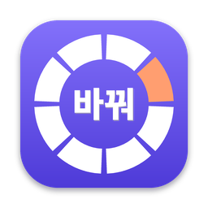
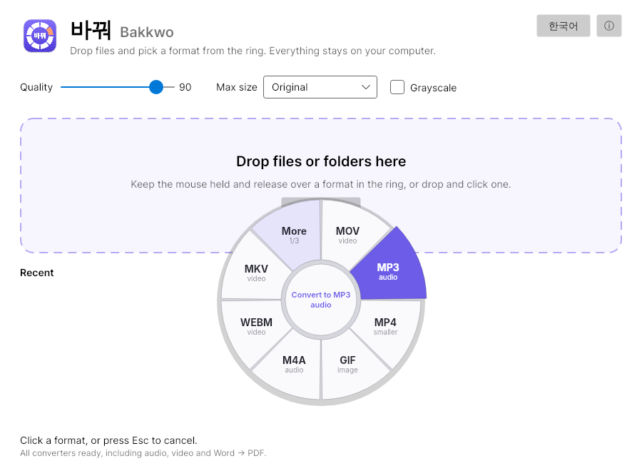
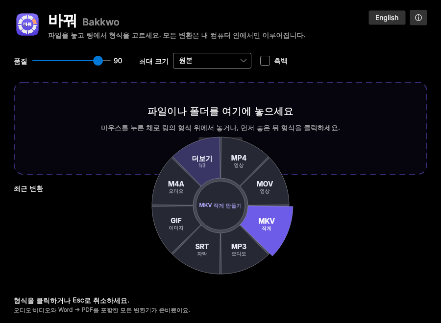

<p align="center"></p>

<h1 align="center">바꿔 Bakkwo</h1>

<p align="center"><b>Drop it. Pick a format. Changed. · 놓고, 고르면, 바뀝니다.</b></p>

A free, offline, cross-platform file converter written in C# with .NET 8 and Avalonia.

*Bakkwo* (바꿔) is Korean for "change it!". Drag files onto the window and a ring of formats opens under your
cursor, showing only the formats those files can actually become. Release over one and the converted
files appear next to the originals. Nothing is uploaded anywhere.

<p align="center">
  
  
</p>

## Download

Get the latest version from the **Releases** page:

| Your computer | Download |
| --- | --- |
| **Windows 10/11** | `Bakkwo-…-win-x64-Setup.exe` (installer) or the portable `.zip` |
| **Mac with Apple Silicon** (M1–M4) | `Bakkwo-…-macos-arm64.zip` |
| **Mac with Intel** | `Bakkwo-…-macos-x64.zip` |
| **Linux** (Ubuntu, Fedora, …) | `Bakkwo-…-linux-x64.tar.gz`, unpack and run `./install.sh` |
| **Android phone** (Android 7+) | `Bakkwo-…-android.apk`, open it on the phone and allow installing |

Each install adds Bakkwo to the app menu with its icon and to **Open with** for the files it converts.
On Windows the installer can also add **"Convert with 바꿔"** to the right-click menu. Selecting several
files sends them all to one Bakkwo window.

For audio and video, install [FFmpeg](https://ffmpeg.org) (Mac: `brew install ffmpeg`, Windows:
`winget install ffmpeg`, Linux: `sudo apt install ffmpeg`). For DOC/RTF/ODT and Word → PDF, install
[LibreOffice](https://www.libreoffice.org). Bakkwo finds both automatically.

> The Mac app isn't notarized yet: the first time, right-click it → **Open**. Windows SmartScreen may ask
> once: **More info → Run anyway**.

### On your phone (Android)

The phone app has the same ring: tap **Convert files** (or **Share → 바꿔** from Gallery, My Files or any
app), then tap a format, or slide your finger around the ring and let go on one. Results are **saved to
Download/Bakkwo** or **shared** straight to another app. Everything runs on the phone.

It converts photos (including **HEIC** from Samsung and iPhone cameras, decoded by Android itself), images
to PDF, Word (DOCX ↔ Markdown/text), text, data and ZIP, and copies a video's sound to **M4A** without
re-encoding. Other video and audio conversions and Word → PDF need FFmpeg and LibreOffice, so they stay
in the computer version. An iPhone version is planned.

## Features

- **Ring menu at the cursor** — a custom-drawn Avalonia control. Keep the mouse held and release over
  a slice, or drop first and click one. The first ring shows only the 7 most relevant choices for that
  kind of file (a video gets MP4, MOV, MP3, GIF, "smaller", and SRT if it has subtitles); every slice has
  a caption ("audio", "smaller", "자막"), the slice under the pointer grows, and the middle explains it
  ("Convert to MP3 audio"). Everything else is one slice away under **More**.
- **Route planning** — formats form a graph and converters are its edges. Dijkstra's algorithm finds
  the cheapest chain, so YAML → CSV works via JSON and Markdown → text works via HTML, without a
  converter written for each pair.
- **Parallel batches** with per-file progress; output names never overwrite anything (`photo (1).webp`).
- **Shrink without changing format**: pick the file's own format (captioned "smaller") with a Max size to
  get `clip (720p).mp4` or a smaller photo.
- **Image options**: quality, maximum size and grayscale. EXIF rotation is applied automatically.
- **Word documents**: a built-in DOCX reader and writer (Open XML SDK) keeps headings, lists, tables,
  links, code and pictures, and understands documents from Korean Word. LibreOffice, when installed,
  adds DOC/RTF/ODT and an exact-layout PDF.
- **Hand-written writers** for multi-size `.ico` files and image-to-PDF (a minimal PDF 1.4 writer that
  embeds JPEG data directly).
- **Command-line tool** that shares the same engine.
- **Korean and English** (한국어 / English). It follows the system language and can be switched
  with one click; the choice is remembered.
- **A real Mac app**: its own icon in the Dock and Finder, shown as 바꿔 on a Korean Mac, an About
  window and app menu, listed under Finder's **Open With** for the formats it converts, and files
  dropped on the Dock icon open straight into the ring.
- **Light and dark themes**, following the system.

## Formats

| From | To |
| --- | --- |
| **Images**: JPG, PNG, WebP, GIF, BMP, TIFF, TGA | each other, ICO, PDF |
| **Word**: DOCX, DOCM, DOTX | Markdown, TXT, HTML; PDF, DOC, RTF, ODT² |
| **Word (older/other)**²: DOC, DOT, RTF, ODT | DOCX, PDF, DOC, RTF, ODT, TXT, HTML, Markdown |
| **Markdown, TXT** | DOCX (headings, lists, tables, links, pictures); PDF² |
| **Data**: JSON, YAML, CSV, TSV, XML | each other |
| **Text**: Markdown, HTML, TXT | HTML, TXT |
| **Archives**: ZIP, TAR, TAR.GZ | each other, extract to a folder; any files or folders → one ZIP |
| **Video**¹: MP4, MOV (incl. iPhone HEVC), MKV, WebM, AVI, WMV, FLV, MPEG, TS, 3GP, OGV, VOB | each other, animated GIF, any audio format; same format smaller (4K / 1080p / 720p) |
| **Audio**¹: MP3, M4A, Apple Lossless, AAC, WAV, FLAC, OGG, Opus, AIFF, WMA, AMR | each other |
| **Subtitles**¹: SRT, WebVTT, ASS/SSA, or a text subtitle track inside MKV/MP4/MOV/WebM/TS | SRT, WebVTT, ASS (offered only when the video has a text track; picture subtitles can't become text) |

**Subtitles stay with the video.** Converting a video keeps its subtitles where the new format can hold them: text
subtitles become a switchable track (MP4/MOV, WebM, MKV); picture subtitles from TV, DVD or Blu-ray (DVB, VobSub,
PGS) stay a track in MKV/TS and are burned into the picture for MP4/MOV/WebM, which can't store them.
`.ts` recordings and downloads (including HLS segments that start with an ID3 tag) are recognised by their packets.

¹ Needs [FFmpeg](https://ffmpeg.org) (`brew install ffmpeg`). Bakkwo asks FFmpeg which encoders it has and
falls back where it can (OGG → Opus when there's no Vorbis encoder, as in Homebrew's build) or hides what that
build can't write (AMR, OGV).
² Needs [LibreOffice](https://www.libreoffice.org) (`brew install --cask libreoffice`) for an exact-layout PDF and
the older formats. DOCX ↔ Markdown/text/HTML is built in and needs nothing else.

Without an optional engine, its formats are simply left out of the ring and the app says how to enable them.

## Run it

You need the [.NET 8 SDK](https://dotnet.microsoft.com/download/dotnet/8.0) (8.0.400 or newer).
On macOS: `brew install --cask dotnet-sdk`, or download the Arm64 installer for Apple Silicon.

```bash
git clone https://github.com/<your-username>/Bakkwo.git
cd Bakkwo
dotnet run --project src/Bakkwo.App      # the desktop app
dotnet test                              # the test suite (81 tests)
```

On macOS you can also double-click `build.command` to run the tests and save the output to
`build-log.txt`, or `setup-mac.command` to install the .NET 8 SDK and FFmpeg first.

### Build the apps

```bash
./build/package-mac.sh                 # → publish/Bakkwo.app (Apple Silicon; RID=osx-x64 for Intel)
./build/package-linux.sh               # → publish/Bakkwo-<version>-linux-x64.tar.gz (RID=linux-arm64 too)
dotnet publish src/Bakkwo.App -c Release -r win-x64 --self-contained -o publish/Bakkwo-win-x64
iscc /DAppVersion=<version> build\windows\bakkwo.iss   # Windows installer (Inno Setup, on Windows)
./build/package-android.sh             # → publish/Bakkwo-<version>-android.apk
```

The Android build needs `dotnet workload install android`, JDK 17 and the Android SDK (Android Studio
installs both); see the top of `build/package-android.sh`. To try the phone screen on a computer, run
`dotnet run --project src/Bakkwo.Mobile.Desktop`.

Pushing a tag like `v0.6.0` runs `.github/workflows/release.yml`, which tests on Windows, macOS and Linux,
builds every package above (including the Android APK) and attaches them to a GitHub Release. The icon is generated by
`build/icon/make_icon.py`.

## Command line

```bash
dotnet run --project src/Bakkwo.Cli -- convert photo.png --to webp -q 80
dotnet run --project src/Bakkwo.Cli -- convert *.csv --to json -o converted
dotnet run --project src/Bakkwo.Cli -- route yaml csv      # yaml → json → csv
dotnet run --project src/Bakkwo.Cli -- pdf scan1.jpg scan2.jpg -o scans.pdf
dotnet run --project src/Bakkwo.Cli -- zip report.docx images/ -o bundle.zip
dotnet run --project src/Bakkwo.Cli -- formats
```

## How it's built

```
src/
  Bakkwo.Core/     conversion engine, no UI
    Formats/         format catalog and detection (handles double extensions like .tar.gz)
    Conversion/      IConverter contract, RoutePlanner (Dijkstra), ConversionEngine, OutputPaths
    Converters/      Image, ImageToPdf, Data, Text, Archive, FFmpeg
    Data/            JSON-hub transforms: YAML, CSV/TSV (RFC 4180), XML
    Pdf/             minimal PDF writer
  Bakkwo.UI/       shared by the desktop and phone apps: the DonutMenu ring control, what the ring
                   suggests for each kind of file (FormatRing), Korean/English texts, settings
  Bakkwo.App/      Avalonia desktop app (Windows, macOS, Linux)
  Bakkwo.Mobile/   the phone screen (Avalonia), independent of Android so it can run anywhere
  Bakkwo.Mobile.Desktop/  runs the phone screen in a window, for trying it out
  Bakkwo.Android/  Android app: share-sheet and "Open with" entry, save to Downloads, and native
                   converters (HEIC via ImageDecoder, video → M4A via MediaExtractor/MediaMuxer)
  Bakkwo.Cli/      command-line front end
tests/
  Bakkwo.Core.Tests/   xUnit tests for planner, transforms and end-to-end conversions
```

Adding a format means writing one class that lists its edges and implements `ConvertAsync`.
The planner, the ring, batching and the CLI pick it up automatically. See
[docs/ARCHITECTURE.md](docs/ARCHITECTURE.md).

## Security

Bakkwo never uploads anything. Known dependency advisories and why they're acceptable for a
local tool are listed in [SECURITY.md](SECURITY.md).

## Credits

The ring-at-the-cursor interaction is inspired by [Filee](https://github.com/KnifeLemon/Filee) by
KnifeLemon (MIT). Bakkwo is an independent implementation written from scratch.

Libraries: [Avalonia](https://avaloniaui.net) (MIT), [ImageSharp](https://github.com/SixLabors/ImageSharp)
(Six Labors Split License, free for open-source use; pinned to 3.1.x, which needs no licence key), [YamlDotNet](https://github.com/aaubry/YamlDotNet)
(MIT), [Markdig](https://github.com/xoofx/markdig) (BSD-2),
[Open XML SDK](https://github.com/dotnet/Open-XML-SDK) (MIT); optional [LibreOffice](https://www.libreoffice.org) (MPL-2.0) and FFmpeg run as separate programs.

## License

MIT © 2026 Khamis Abdulkarim Ali. Components included in the app packages are listed in
[THIRD-PARTY-NOTICES.md](THIRD-PARTY-NOTICES.md).
